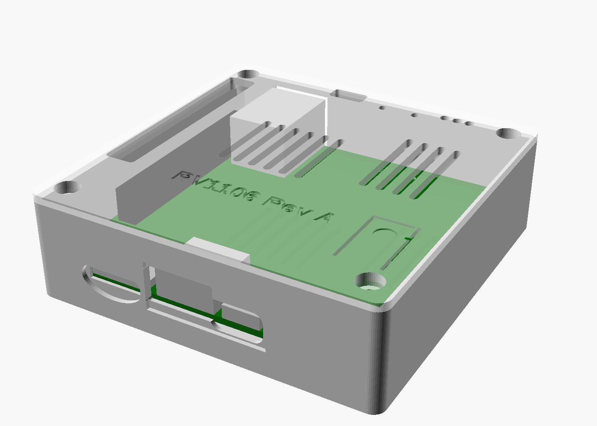
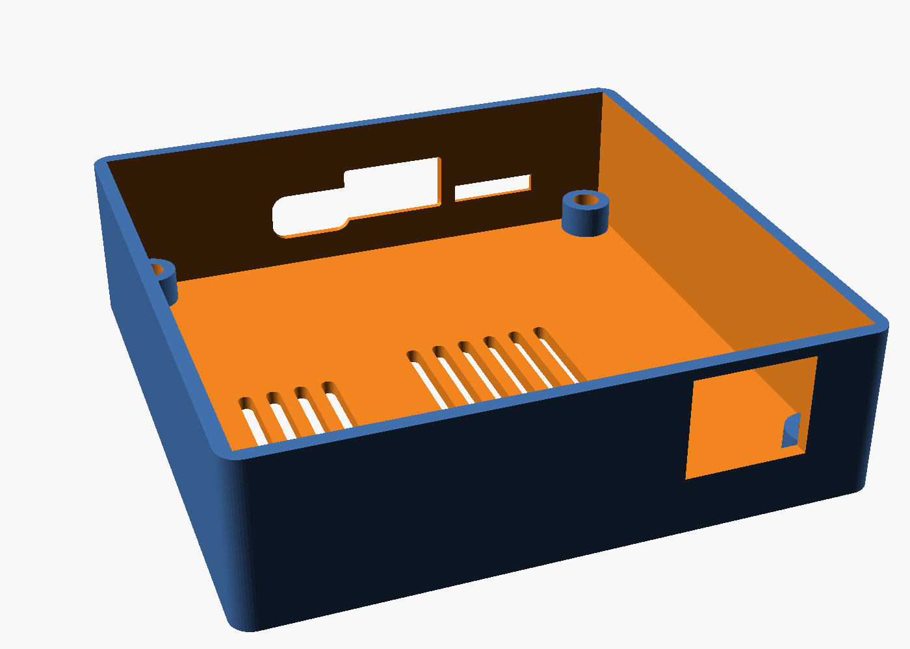
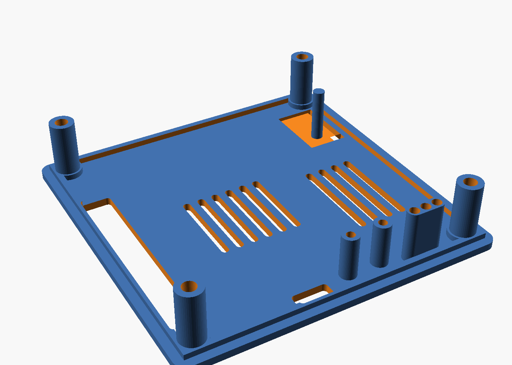

# Enclosure for the RV1106 Rev A board

A two-part, 3D-printable case: a **tray** that holds the board on four standoffs, with the connectors reachable through
the walls, and a **lid** with openings for the header and UART. The lid also has a flexure that presses the power
button, pinholes for RESET / MASKROM, light tubes for the three LEDs, and vents. Outside: 85 × 85 × 26 mm (95 × 85 mm
with rails).

| Tray (south wall: microSD, USB-A, USB-C) | Lid underside (posts, plunger, light tubes) |
|---|---|
|  |  |

## Files

| File | Use it when |
|---|---|
| `stl/rv1106_tray_rails.stl`, `stl/rv1106_lid_rails.stl` | the 5 mm V-cut rails are **still on** the board (90 × 80 mm, as delivered) |
| `stl/rv1106_tray.stl`, `stl/rv1106_lid.stl` | the rails have been **snapped off** (80 × 80 mm) |
| `rv1106_case.scad` | source (OpenSCAD). Every dimension is a parameter at the top of the file |

Regenerate: `openscad -D 'part="tray"' -D 'rails=true' -o stl/rv1106_tray_rails.stl rv1106_case.scad`. `part` is
one of `tray`, `lid`, `assembly`, `print`.

## Where the geometry comes from

Everything is in board coordinates taken from `design/pcb/rv1106-reva.kicad_pcb` (KiCad − (50, 50), +y south), with
`design/layout.md` §1 and the connector datasheets in `design/refs/`:

| Feature | Board position | Opening |
|---|---|---|
| M3 holes H1–H4 | (3.5, 3.5) (76.5, 3.5) (3.5, 76.5) (76.5, 76.5) | tray standoffs Ø7.8, lid posts Ø6.5 (inside the 7 mm keep-out) |
| RJ45 J3 (north) | x 9.00–25.04, 13.5 mm tall | 16.8 × 14.3 mm |
| microSD J2 (south) | card centre x 18.5 (`zones.csv` still says 19.5, which is stale) | 13.5 × 2.9 mm + finger scoop |
| USB-A J4 / USB-C J1 (south) | x 35.75 / 49.5 | one shared opening; the wall is thinned to 1.0 mm there so plug boots seat fully |
| 2x20 header J5, UART J6 | (3.0, 9.56), (30.77, 2.77) | open in the lid |
| SW1 power | (71.5, 60) | flexure tongue, 1.0 mm thick, with a plunger 0.4 mm above the switch |
| SW2 RESET / SW3 MASKROM | (44.2, 5.2) / (53.0, 5.2) | Ø2.2 paperclip holes with guide tubes |
| LED1–3 | (60.0 / 63.2 / 66.4, 3.0) | Ø2.5 windows on a light-pipe bar |

The board has no parts on the bottom. The 5 mm standoffs clear the through-hole leads, which stick out 2.7–3.05 mm.

## Print and assemble

- **Material:** PETG or PLA, 0.2 mm layers, no supports. The tray prints upright. The lid prints top-down; the STL is
  already oriented that way. PETG is better for the power-button flexure.
- **Print service:** for JLC3DP choose MJF nylon (PA12). Their checker asks for walls of at least 1.2 mm, but the case
  has 1.0 mm walls at the USB ports and at the flexure, so it may flag them. The design was reviewed with those values.
- **Hardware:** 4 × M3 heat-set inserts (Ø4.2 hole, 5 mm long) go in the tray standoffs. 4 × M3×20 socket-head screws
  go through the lid and the PCB into the inserts: 3.9 mm thread engagement, 2.1 mm tip clearance. For self-tapping
  screws, set `insert_d = 2.6`. 4 × 10 mm bump-on feet are optional.
- **Assembly:** lower the board straight down into the tray (no connector sticks out past the board edge), put the
  lid on, and fit the screws.

## Not verified on hardware

The design was reviewed three times against the KiCad file and the datasheets, but it has not been printed yet. The
connector heights come from the datasheets. Before printing, measure the RJ45 (13.5 mm) and the USB-A (6.9 mm) on a
real board.
