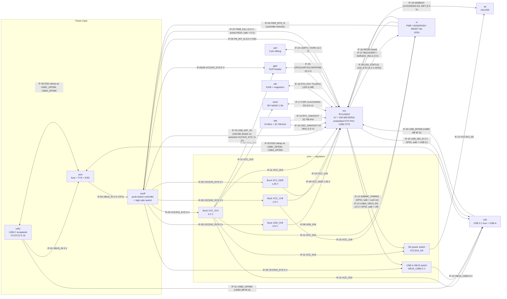

# Architecture & block diagram (Phase 1, Rev A)

Board: RV1106G3 (QFN128, 256 MB DDR3L in package) Linux board, **80 × 80 mm** (D-61, D-H2, D-84 round 2: 70 × 70 mm until Phase 7, which enlarged it so the
placement zones hold their courtyards; was ~60 × 50 mm in Phase 1),
4-layer JLC04161H-7628 1.6 mm, **ENIG** (D-62), **JLCPCB Standard PCBA**, single-sided assembly, 2 × 5 mm edge rails +
fiducials (D-61, D-67). Rev A order: 2 assembled boards + 3 bare PCBs (D-H2).
Baseline: **copy the Luckfox Pico Pro/Max** [LF] wherever possible; every deviation is listed in `decisions.md`.
Sources [DS], [LF], [JLC] are defined in `requirements.md` (URLs + local copies under `design/refs/`).

Pin numbers below come from [DS] Table 2-1 "Pin Number Order Information" (pp. 18–19). The final pin choice for each
signal, and the supply domain of each pin, are confirmed in Phase 2 (`pinmap.csv`). Where a domain below is only an
inference from where the pins sit, it is marked **(P2-confirm)**.

## 1. Block list

| id | Block | Contents (Rev A intent) | Primary reference |
|---|---|---|---|
| `usbc` | USB-C receptacle | 16-pin USB 2.0 Type-C receptacle; CC1/CC2 each 5.1 kΩ to GND (sink, default 5 V, no PD); D+/D− to the USB mux (`usb`); VBUS to `prot`. The [LF] VBUS sense divider is **not** on raw VBUS here: it moves to the switched VCC5V0_SYS (see `onoff`, IF-23, D-27) | [LF] "Type-C" block (R3/R6 5.1K, R2 10K / R5 18K → USB_DET_IN) |
| `prot` | Input protection | Resettable fuse (or eFuse), TVS on VBUS, ESD array on the USB D+/D− lines of both connectors (IF-30) | Deviation D-04 (not on [LF]) |
| `onoff` | Push-button on/off controller | Push-button controller IC + high-side P-MOSFET/load switch VBUS_5V → VCC5V0_SYS; outputs `PB_INT_N` to SoC, input `PWR_KILL` (active-high, inactive at 0 V; inverted locally to PWR_KILL_N if the IC needs it) from SoC; hard-off after ≥ 8 s hold | Deviation D-03 (not on [LF]); IC chosen in Phase 3 |
| `pmu` | Power regulators (no PMIC) | 4 buck converters copied from [LF]: VDD_0V9 (CPU+logic+PMU core), VCC_DDR 1.35 V, VCC_1V8, VCC_3V3; plus SD card power switch (P-FET), RTC supply diode, USB-A VBUS current-limit switch | [LF] "Setp 1 VCC5V0_SYS--->VDD_0V9" (U4), U5 (VCC_1V8), U7 (VCC_DDR), U6 (VCC_3V3), "Card Power" Q1 SI2301, "RTC Power" D2/D3 B5819WS |
| `soc` | RV1106G3 | Cortex-A7 + 2 Gb DDR3L in package; nPOR RC; DRAM_ZQ resistor; all supply decoupling; embedded Ethernet PHY; one USB 2.0 OTG PHY | [DS] §1.1 p.6, §2.1 p.15; [LF] centre sheet |
| `xtal` | Clocks | 24 MHz crystal on OSC_XIN/OSC_XOUT; 32.768 kHz crystal on RTC_XIN/RTC_XOUT | [DS] §1.2.3 p.7; [LF] Y1 "24MHz", Y2 "32.768KHz" |
| `nand` | SPI NAND | 2 Gb SPI NAND (W25N02KV-class, copy of [LF] U2) on FSPI, 3.3 V, quad mode | [LF] U2 "W25N02KVZE", VCCIO_FLASH = VCC_3V3 |
| `sd` | microSD | Push-push microSD socket on SDMMC0 (4-bit), card detect, card power switched by SoC GPIO | [LF] "Micro-SD Card" TF1 + "Card Power" Q1 |
| `eth` | Ethernet | RJ45 with integrated magnetics on the SoC's embedded PHY (TX±, RX±), ETH_EXTR bias resistor, 0 Ω series links, Bob-Smith termination in the jack | [DS] §1.2.13 p.13; [LF] "Ethernet" J2 |
| `usb` | USB host + mux | USB 2.0 2:1 analog mux routing the single SoC USB port to either USB-C (device/MASKROM) or USB-A (host); USB-A receptacle with switched 5 V VBUS | Deviation D-05 ([LF] routes SoC USB only to its USB-C) |
| `gpio` | 2×20 expansion header | 2.54 mm 2×20: GPIO, UART, I²C, SPI, PWM, 3.3 V, 5 V, GND (3.3 V logic) | [LF] U3 40-pin Pico-style pinout; signal list Phase 2 |
| `uart` | Debug UART header | 3-pin 2.54 mm: GND, UART2_TX, UART2_RX (3.3 V) | [LF] U3 GP00/GP01 = UART2_TX/RX; SoC pins 79/80 |
| `ui` | Buttons & LEDs | POWER button (to `onoff`), MASKROM/RECOVERY button, RESET button, power LED, status LED (net LED_STATUS, pin 62; [LF] label LED_GREEN, renamed D-69), Ethernet activity LED | [LF] "System RECOVERY Key" Key2, "Power Reset" Key1, net LED_GREEN on U1 pin 62 |

## 2. Block diagram



Every arrow carries its IF number. **The §4 IF table is the authoritative list of interfaces**; the diagram draws every
IF row except IF-02 (CC1/CC2 → 5.1 kΩ → GND, internal to `usbc`) and IF-29 (PWR LED, drawn as the VCC_3V3 → `ui` arrow
together with IF-11).

## 3. Power tree (architecture level — numbers and sequencing in Phase 3)

> **Phase 3 update (2026-10-28):** the detailed power tree, rail table, sequencing, budget, USB-C sink/protection and the on/off
> controller (LTC2954-2 + AO3401A, KILL pull-up to VCC_3V3) are in `power.md` (D-32..D-40). Where this section and `power.md`
> differ, `power.md` wins.

```
USB-C VBUS_IN ─▶ prot (fuse, TVS) ─▶ VBUS_5V [TP1] ─┬─▶ onoff controller supply (always on while cable present)
                                                    └─▶ onoff high-side switch ─▶ VCC5V0_SYS
VCC5V0_SYS ─┬─▶ Buck U4-type  ─▶ VDD_0V9 [TP4]  ─▶ CPU_DVDD, DVDD_1..7, PMU_DVDD0V9, OSC_PLL_DVDD
            ├─▶ Buck U7-type  ─▶ VCC_DDR 1.35 V [TP5] ─▶ DDR_VDDQ_1..3
            ├─▶ Buck U5-type  ─▶ VCC_1V8 [TP3]  ─▶ OSC/PLL_AVDD1V8, DDR_PLL_AVDD1V8, SARADC_USB_AVDD1V8,
            │                                       OTP/ETH/TSADC_AVDD1V8, CODEC_AVDD1V8, MIPI_AVDD1V8/GPIO7_VCC1V8
            ├─▶ Buck U6-type  ─▶ VCC_3V3 [TP2]  ─▶ PMU_VCC3V3, GPIO1_VCC3V3, USB_AVDD3V3, ETH_AVDD3V3,
            │                                       GPIO3..6_VCC (3.3 V mode), SPI NAND, header 3V3, mux
            │                     ├─▶ P-FET (SDMMC_PWREN) ─▶ VCC3V3_SD ─▶ microSD
            │                     └─▶ diode ─▶ VCC3V3_RTC ─▶ RTC_AVDD3V3
            ├─▶ current-limited switch (USBA_VBUS_EN) ─▶ VBUS_USBA ─▶ USB-A
            ├─▶ 10k/18k divider ([LF] R2/R5) ─▶ USB_DET_IN ─▶ SoC pin 25 USB_VBUSDET (D-27; never from raw VBUS)
            └─▶ header 5 V pins (output only)
```

Supply pin names and allowed ranges: [DS] Table 3-1 (p.20, absolute) and Table 3-2 (p.20, recommended):
CPU_DVDD 0.85–0.90–1.05 V; DVDD_i and PMU_DVDD0V9 0.81–0.90–0.95 V; DDR_VDDQ 1.283–1.35–1.45 V;
1.8 V analog rails 1.62–1.8–1.98 V; 3.3 V rails 3.0–3.3–3.465 V (ETH_AVDD3V3 2.97–3.63 V).
[LF] feeds CPU_DVDD from the same 0.9 V buck as logic through a 0 Ω (R32, net VDD_0V9 → VDD_ARM); we copy the shared rail (D-06), but [LF] prints R32 "0R 5% DNP", so here VDD_0V9 → VDD_ARM is a **direct copper connection / net-tie NT_ARM** (no 0R part), and U4's current-measurement point is a normally-closed solder jumper JP_MEAS_0V9 (D-06 round 3, D-68).
[LF] sequencing as drawn: VDD_0V9 is "Setp 1"; U5 (VCC_1V8) and U7 (VCC_DDR) EN are on net VCC_DDR_1V8_EN; U6 (VCC_3V3) EN is on PWR_EN through
R43 200 kΩ with an RC to GND. Exact order vs. datasheet → Phase 3 (TP-D3).

**PWR_EN must be driven high in our design (closed in Phase 3 by D-34/D-38 round 2; see power.md §3).** On [LF] the only pull-up
to PWR_EN is R41, printed "1K/NC" (may be unfitted) and fed from VCC5V0_SYS, and PWR_EN also goes to the header pin "3V3_En" through
R24 0R ([LF] sheet, area around R41/R43 next to U6; a "DNP" text sits next to R24 in the extracted text, so whether R24 is fitted on [LF]
is UNVERIFIED — irrelevant for us, since we do not fit it). If R41 were left unfitted and nothing drove the header pin, U6 would never
enable, VCC_3V3 would never rise and the board would not boot. **Rev A rule (D-34/D-38 round 2): fit R41 = 1 kΩ fed from VCC_1V8
(not from VCC5V0_SYS) to PWR_EN, with R43 200 kΩ and C65 = 150 nF (not [LF]'s 100 nF) from PWR_EN to U6 EN/GND.** This makes 3.3 V
wait for 1.8 V by construction; feeding R41 from VCC5V0_SYS would let U6 start before VCC_DDR is up (power.md check P7b fails).
Rev A drops the header "3V3_En" pin (D-08: header power pins are outputs only), so R24 is not fitted.
[LF] also has an NC 0 Ω option FB4 from VCC_1V8 to VCC_DDR (for 1.8 V DDR2 variants); a Luckfox forum thread
(https://forums.luckfox.com/viewtopic.php?t=812 — page returned HTTP 403 to our fetch, so we could not read it; known only from a search-result summary, UNVERIFIED) reports an older sheet
revision where VCC_DDR was tied to 1.8 V. **Rev A does not fit FB4. VCC_DDR is only the 1.35 V buck**, as [DS] Table 3-2 requires.

## 4. Interfaces between blocks (named, with signal type and voltage)

| IF | Net name(s) | From → To | Signal type | Voltage / level | SoC pins ([DS] Table 2-1) | Source |
|---|---|---|---|---|---|---|
| IF-01 | VBUS_IN | usbc → prot | Power | 5 V nominal (USB default power) | — | [LF] Type-C VBUS |
| IF-02 | CC1, CC2 | usbc → GND via 5.1 kΩ | Config (static pull-down) | 0–5 V (Rd) | — | [LF] R3, R6 5.1K |
| IF-03 | VBUS_5V | prot → onoff | Power (fused) | 5 V ±5 %, ≤ 1.5 A budget | — | PLAN TP1 |
| IF-04 | PWR_BTN_N | ui → onoff | Digital, active-low push-button to GND | controller's PB pin (pulled up inside the controller, VBUS_5V domain; level set by IC — Phase 3) | — | D-03 |
| IF-05 | VCC5V0_SYS | onoff → pmu, gpio | Power (switched) | 5 V | — | [LF] net VCC5V0_SYS |
| IF-06 | PB_INT_N | onoff → soc | Digital interrupt, open-drain, active-low | 3.3 V pull-up | GPIO in PMU_VCC3V3 or GPIO1_VCC3V3 domain (P2-confirm) | D-03 |
| IF-07 | PWR_KILL (SoC side, **active-HIGH**); PWR_KILL_N (controller side, only if the controller's KILL input is active-low) | soc → onoff | Digital kill request, push-pull from SoC; 100 kΩ external pull-down to GND on PWR_KILL. If the controller wants active-low: N-MOSFET inverter (gate = PWR_KILL with the pull-down, source GND, drain = PWR_KILL_N with pull-up to the controller's own always-on supply) | 3.3 V SoC side; controller side = controller supply (VBUS_5V domain) | candidate GPIO0_A4 = PMIC_PWR_CTRL_M0 (pin 63, PMU domain, **reset default pull-down** `GPIO0_A4_d`) (P2-confirm) | [DS] Table 2-1 p.19 pin 63 "PMIC_PWR_CTRL_M0/PWM1_M0/GPIO0_A4_d"; D-03 |
| IF-08 | VDD_0V9 (+VDD_ARM via 0 Ω) | pmu → soc | Power | 0.90 V | 10, 51, 54, 55, 82, 103, 116 (DVDD_1..7), 115 (CPU_DVDD), 67 (PMU_DVDD0V9), 71 (OSC_PLL_DVDD) | [DS] pp.18–20; [LF] U4 |
| IF-09 | VCC_DDR | pmu → soc | Power | 1.35 V | 49, 50, 56 (DDR_VDDQ_1..3) | [DS] Table 3-2; [LF] U7 |
| IF-10 | VCC_1V8 | pmu → soc, ui (RECOVERY 10 kΩ pull-up) | Power | 1.8 V | 1, 24, 31, 53, 70, 96 | [DS] Table 3-2; [LF] U5 |
| IF-11 | VCC_3V3 | pmu → soc, nand, gpio, usb (mux), ui (PWR LED, LED anodes), sdsw | Power | 3.3 V | 13, 19 (via RTC diode), 28, 43, 61, 81, 88, 101, 108 | [DS] Table 3-2; [LF] U6 |
| IF-12 | VCC3V3_SD / SDMMC_PWREN | pmu(sd switch) → sd; soc → switch gate | Power / digital enable (active-low P-FET gate; safe state = card powered, needed for SD boot) | 3.3 V | [LF] draws SDMMC_PWREN on pin 59 (GPIO0_A1_d, PMU domain): reset pull-down → gate low → card powered, consistent with the safe state (P2-confirm) | [LF] "Card Power" Q1 SI2301 |
| IF-13 | VBUS_USBA / USBA_VBUS_EN | pmu(usbsw) → usb; soc → usbsw EN | Power 5 V, ≥ 500 mA current limit / digital enable, active-high; **safe state = off** | 5 V / 3.3 V | GPIO whose reset pull is **pull-down** (`_d`), plus external pull-down; if the pin is `_u`, the external pull-down must be ≤ 10 kΩ (P2-confirm, §4.1) | D-05 |
| IF-14 | OSC_XIN, OSC_XOUT | xtal ↔ soc | Analog crystal (24 MHz) | OSC_AVDD1V8 domain (1.8 V) | 68, 69 | [DS] p.18; [LF] Y1 |
| IF-15 | RTC_XIN, RTC_XOUT | xtal ↔ soc | Analog crystal (32.768 kHz) | RTC_AVDD3V3 domain | 21, 20 | [DS] p.18; [LF] Y2 |
| IF-16 | NPOR | ui/soc RC → soc | Digital reset, active-low | PMU domain 3.3 V (P2-confirm) | 66 | [DS] p.19; [LF] "Power Reset" |
| IF-17 | FSPI_CLK, FSPI_CS0N, FSPI_D0..D3 | soc ↔ nand | SPI (quad) single-ended | GPIO3_VCC = 3.3 V (P2-confirm) | 48, 47, 41, 42, 44, 39 | [DS] p.18–19; [LF] U2, VCCIO_FLASH=VCC_3V3 |
| IF-18 | SDMMC_CLK, SDMMC_CMD, SDMMC_D0..D3, SDMMC_DET | soc ↔ sd | SD 4-bit single-ended (default/high speed) | GPIO4_VCC = 3.3 V (P2-confirm) | 15, 16, 14, 12, 18, 17, 11 | [DS] p.18; [LF] TF1 |
| IF-19 | ETH_PHY_TXP/TXN, ETH_PHY_RXP/RXN | soc ↔ eth | 10/100BASE-TX differential, 100 Ω | ETH_AVDD3V3 / ETH_AVDD1V8 analog | 100, 99, 98, 97 (+ETH_EXTR 102) | [DS] p.18–19; [LF] J2 |
| IF-20 | USB_DP, USB_DM | soc ↔ usb (mux common port) | USB 2.0 HS differential, 90 Ω | USB_AVDD3V3 / SARADC_USB_AVDD1V8 | 27, 26 | [DS] p.18, Table 3-7 p.22 |
| IF-21 | USBC_DP/DM, USBA_DP/DM | usb mux ↔ usbc / USB-A | USB 2.0 HS differential, 90 Ω | 3.3 V max (Table 3-7) | — | D-05 |
| IF-22 | USB_SEL | soc → usb mux | Digital select; **safe state = USB-C selected** (polarity fixed by the mux part in Phase 4) | 3.3 V | GPIO whose reset pull agrees with the USB-C level, plus external resistor to that level; if it disagrees, external resistor ≤ 10 kΩ (P2-confirm, §4.1) | D-05 |
| IF-23 | USB_DET_IN → USB_VBUSDET | onoff (VCC5V0_SYS) → soc | VBUS detect: 10 k/18 k divider ([LF] R2/R5) fed from the **switched VCC5V0_SYS**, not raw USB-C VBUS, so no voltage reaches the SoC while it is off with the cable plugged in (D-27). High whenever the SoC is on, because USB-C is the only power input | ≈ 3.2 V from 5 V; VBUSDET input threshold/max UNVERIFIED in [DS] | 25 | [LF] R2/R5; [DS] Table 2-1 p.18; D-27 |
| IF-24 | UART2_TX, UART2_RX | soc ↔ uart | UART, 3.3 V CMOS | GPIO1_VCC3V3 = 3.3 V | 79 (UART2_TX_M1), 80 (UART2_RX_M1) | [DS] p.18 + Table 3-2; [LF] U3 GP00/GP01 |
| IF-25 | HDR_* (GPIO, UART, I2C, SPI, PWM) | soc ↔ gpio | General-purpose single-ended | 3.3 V (GPIO1_VCC3V3; GPIO5/6_VCC in 3.3 V mode) | GPIO1_A..D, GPIO2_A/B (exact list Phase 2) | [DS] p.18–19; [LF] U3 |
| IF-26 | 3V3 / 5V / GND on header | pmu → gpio | Power out | 3.3 V, 5 V (switched VCC5V0_SYS) | — | D-08 |
| IF-27 | RECOVERY (SARADC_IN0) | ui → soc | Analog input used as boot key: pulled up to 1.8 V, button to GND | 1.8 V (SARADC_USB_AVDD1V8) | 23 | [LF] "System RECOVERY Key"; [DS] p.18 |
| IF-28 | LED_STATUS (status; [LF] LED_GREEN, renamed D-69), LED_ETH | soc → ui | GPIO driving LED via resistor | 3.3 V | LED_STATUS: **pin 62 = GPIO0_A3_u** (PMIC_PWR_CTRL_M1, PMU domain, 3.3 V), the net [LF] already names LED_GREEN — copy-first candidate (P2-confirm). LED_ETH: 3.3 V GPIO chosen in Phase 2. ([LF] LED1 on GPIO3_C6 pin 4 is not used — D-09) | [LF] net label LED_GREEN at U1 pin 62; [DS] Table 2-1 p.19 "PMIC_PWR_CTRL_M1/GPIO0_A3_u" |
| IF-29 | VCC_3V3 → PWR LED | pmu → ui | Power indicator | 3.3 V | — | D-09 |
| IF-30 | USBC_DP/DM, USBA_DP/DM (ESD) | prot ↔ usbc, usb | ESD clamp (low-capacitance TVS array, shunt to GND) on the USB 2.0 data lines at each connector | clamps above USB 2.0 data-line levels (≤ 3.6 V, [DS] Table 3-7 3.3 V max); part and capacitance limit in Phase 4 | — | D-04 |

Every arrow in §2 is labelled with its IF row; this table is the authoritative list (see note under §2).

### 4.1 Reset-state rule for SoC control outputs (applies to IF-07, IF-12, IF-13, IF-22; checked in Phase 2)
From power-on until Linux owns a pin (BootROM, SPL, U-Boot, kernel: several seconds), and while the SoC is unpowered
(pin at 0 V), every SoC output that controls another block must sit in its **safe state**:

| Net | Safe state | How it is guaranteed |
|---|---|---|
| PWR_KILL (IF-07) | not killing (0 V) | Active-high on a `_d` pin (GPIO0_A4_d) + 100 kΩ external pull-down; 0 V when the SoC is off = inactive. Active-low controller input only through the N-MOSFET inverter, whose drain pull-up goes to the controller's always-on supply. |
| USB_SEL (IF-22) | USB-C selected | Pin's reset pull (`_u`/`_d`, about 50 kΩ internal) equals the USB-C level, plus external resistor; otherwise external resistor ≤ 10 kΩ so it wins. Mux supply is VCC_3V3, so it is unpowered (no path) before 3.3 V. |
| USBA_VBUS_EN (IF-13) | VBUS_USBA off | `_d` pin + external pull-down at the switch EN; otherwise external pull-down ≤ 10 kΩ. The switch is powered from VCC5V0_SYS, so the pull-down also holds EN low before VCC_3V3 rises. |
| SDMMC_PWREN (IF-12) | card powered | [LF] pin 59 GPIO0_A1_d pulls the P-FET gate low = card on (needed for SD boot). |

Phase 2 (`pinmap.csv`) must record each pin's reset pull from [DS] Table 2-1 and check it against this table. Phase 3 checks the controller's KILL input polarity and timing.

## 5. Boot & debug paths (architecture-level)
- BootROM boots from SPI (FSPI), eMMC or SD/MMC, and supports code download over USB or UART ([DS] §1.2.2 p.6).
  Intent: Rev A boots from microSD during bring-up, then from SPI NAND.
  **The BootROM's media search order (SD before or after FSPI), and how to force SD boot once the NAND holds a valid
  image, are UNVERIFIED**: [DS] §1.2.2 only lists the devices. Added to the Phase 2 research list (Rockchip TRM / boot
  docs, Luckfox wiki). Fallback if SD does not win over a programmed NAND: erase the NAND from Linux or U-Boot, or enter
  MASKROM (RECOVERY button) and rewrite/erase it over USB-C with rkdeveloptool.
- MASKROM entry: hold the RECOVERY/MASKROM button (pulls SARADC_IN0 low) while powering on. The BootROM then shows up
  on the USB OTG port ([LF] Key2; behaviour as described by Luckfox community guides — exact BootROM rule UNVERIFIED
  against a Rockchip document, Phase 2). The USB mux must default to USB-C while the SoC is held in reset or in BootROM (D-05).
- Debug console: UART2 (M1 pins 79/80) on a 3-pin header. The baud rate (Rockchip default is 1 500 000) is checked in Phase 8 (UNVERIFIED).

## 6. Test-point anchors (detail in Phase 6)
TP1 VBUS_5V (prot output) · TP2 VCC_3V3 · TP3 VCC_1V8 · TP4 VDD_0V9 · TP5 VCC_DDR · TP6 24 MHz (probe pad on OSC_XOUT; use a low-capacitance 10x probe — method in Phase 6) · TP7 NPOR · TP8a EN̅ (onoff controller output) · TP8b VCC5V0_SYS · TP8c PWR_EN (U6 enable; power.md §6.5, D-50) · TP9/10 UART2_TX/RX · TP11 Ethernet LED / activity GPIO.
**Phase 6 (D-77): the final list is `testpoints.md` (TP1–TP31).** Physical TP8 is now the controller output ONOFF_EN (high when on, power.md TP8a′) and TP12 is EN̅ (power.md TP8a); TP21–TP26 cover VBUS_IN and the five sub-rails; TP27–TP30 the interrupt/kill lines and SD card detect; TP19/20/31 are ground.

## 7. Layout-level constraints identified now (detail Phase 7)
USB 90 Ω differential (IF-20/21), Ethernet 100 Ω differential (IF-19), 24 MHz crystal next to pins 68/69, buck loops
compact, QFN128 0.35 mm pitch with exposed pad = VSS ([DS] p.19 "VSS E-PAD"), all parts on top side (R8).
**Phase 7 (2026-10-29):** the full layout rule book is `layout.md` (stackup use, impedance widths ETH 0.235/0.200 mm and
USB 0.255/0.150 mm, net classes for all 135 nets, floor plan with the SoC rotated +90°, 80 × 80 mm board / 90 × 80 mm panel with west/east
rails, QFN-128 land pattern and thermal vias, DRC checklist); decisions D-81–D-88.
