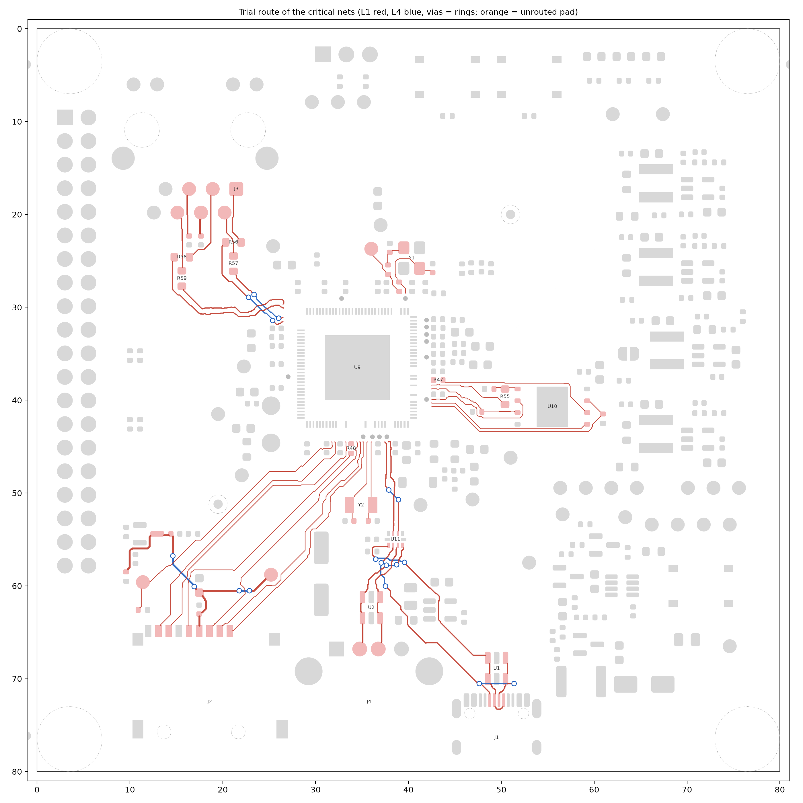
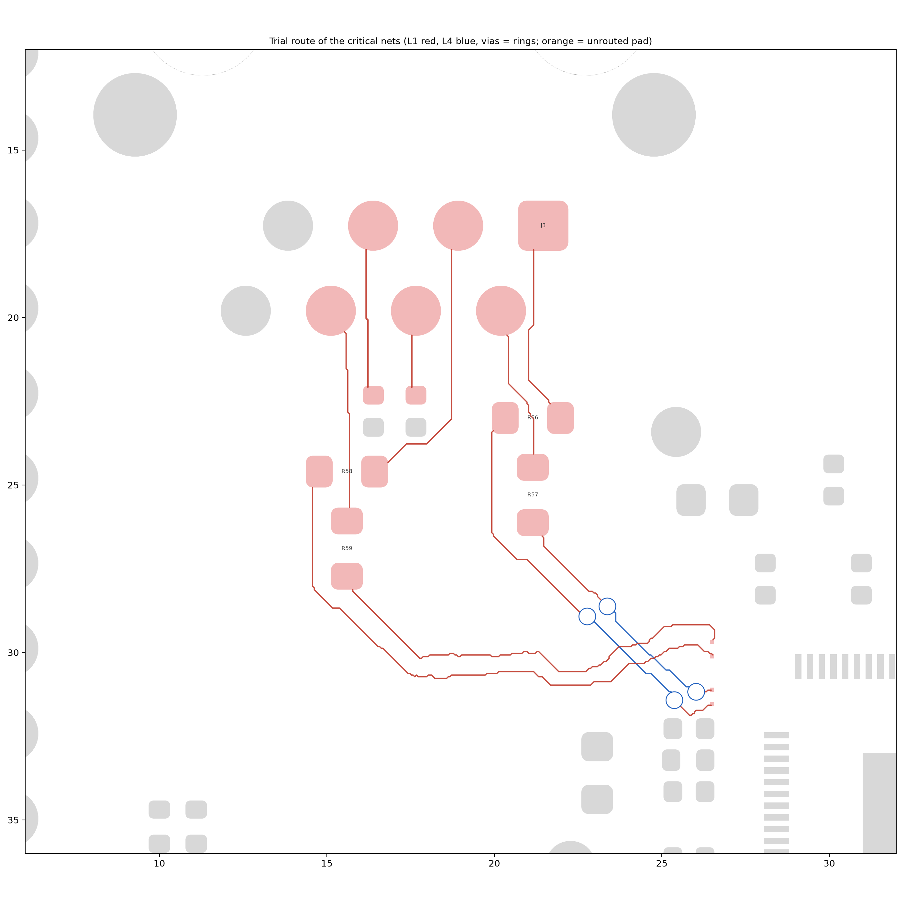

# Placement review — CHECKPOINT 1 (layout phase L2, round 4)

Board `design/pcb/rv1106-reva.kicad_pcb`. Open **`design/pcb/rv1106-reva.kicad_pro`** in KiCad 10 (PCB Editor). There is
no routing yet. Please review the placement before routing starts (PLAN.md, gate TP-L2).

Coordinates are board mm from the NW corner (x east, y south). That corner is at page (50, 50) mm, and the grid origin
and the drill/place origin are set there (D-100), so KiCad's relative coordinates match this file.

## Summary

- **`check_placement.py`: 333 checks, 275 PASS, 58 DEV (recorded deviations), 0 FAIL.** Full listing:
  `check_placement.txt`. kicad-cli DRC: 0 courtyard overlaps, 0 shorts, 0 copper-edge, 0 missing or extra footprints.
  499 unconnected items (expected before routing).
- **Trial route of every critical net** (SDMMC, FSPI, USB, ETH, ETH centre taps, crystals, SDMMC_DET and, new in round
  4, the SD card supply VCC3V3_SD: 38 nets). All 38 route at their class rules with no clearance conflict. L4 is used
  only for the planned hops (D-106, D-108) and the VCC3V3_SD supply. With L1 only, the ETH, SoC USB and USB-C pairs
  cannot route (and 3 SD lines then conflict too, because the card supply must also stay on L1), so the crossings
  are forced.
- **Round 4 (D-108):** the trial now keeps the ETH TX and RX pairs ≥ 0.76 mm apart everywhere, also inside the
  R56–R59 field. The Ethernet topology described in D-106 (b) now really routes that way, and the checker
  re-measures it with exact geometry: **minimum TX–RX gap 0.816 mm**. The trial is deterministic.
- KiCad will ask you to set up the global footprint library table the first time you open the project (this Mac has
  none). Choose the default; the board's footprints are stored in the board file and in `board.pretty/`.
- **Four things need your decision** (section "Decisions for you"). The main one: short **via hops onto L4 for USB and
  for the Ethernet TX pair**. This is a deviation from layout.md §2.3 and §4.2.

## Images

| Image | What it shows |
|---|---|
|  `renders/placement_top.png` | kicad-cli 3-D render, top, high quality. The custom footprints (U9, U11, L1–L4, SW1–3, J2, J4) have no 3-D model, so they show only as pads and silkscreen. |
|  `renders/placement_fab.png` | F.Fab + F.CrtYd (magenta) + F.Cu pads + silkscreen references + Edge.Cuts + V-CUT + the zones.csv rectangles (blue, layer User.2 "PLACE-ZONES"), 2800 px |
|  `renders/placement_soc.png` | Close-up of Z-SOC (ring-1 row and the lanes between its parts), 2400 px |
|  `renders/trial_route_policy.png` | **Trial route** of the 38 critical nets: L1 red, L4 blue, vias as rings. Close-ups: `trial_route_policy_west.png` (ETH to J3), `_usb.png` (USB around U11, U2, U1/J1), `_sd.png` (SD bus and card supply at J2), `_south.png` (SD / RTC / USB), `_east.png` (FSPI around U10) |
|  | ETH close-up: RX pair (north at the gate) to R59/R58, TX pair under it on L4 to R57/R56, P/N swaps at R58 and R56 |
| `renders/trial_route_l1only.png` | The same trial with L1 only. It shows where the forced crossings are: the ETH RX/TX pairs, the SoC USB pair and the USB-C pair (11 nets in conflict). |

## What changed in round 3 (verifier L2 round 2)

| Finding | What was done | Decision |
|---|---|---|
| **SD corridor blocked by Y2** (gap 1.71 mm) | Y2 moved south to (34.90, 51.30), with C78/C79 under its pads. The free height between the ring-1 row (pad bottom y 45.99) and Y2's 1 mm guard is now **3.41 mm** (≥ 2.4 required). U11, C84 and R60 moved below Y2. R32/TP22, the Q4 group and TP16 moved out of the bus path to J2. A new corridor check and the trial route both FAIL with Y2 at its round-2 position, at round-2 + 0.6 mm north, and at today's position − 1.1 mm. | D-105 |
| **FSPI needs two crossings** | Solved **on L1, with no via**. U10 moved 2.5 mm south to (55.5, 40.7). FSPI_CLK_NAND runs straight east over U10's top pad row and down the 1.7 mm channel between the east pads and the exposed pad, to pin 6's inner end. D1 enters between pins 3 and 4 and runs up the west channel to pin 2. R55, R54, R53, R52, C80 and C81 were re-placed around this. The D-104 (i) text is corrected. | D-106 (c) |
| **USB pairs need crossovers** | U1 rotated 90° so the USB-C pair needs no P/N swap before J1. Planned hops: **USB_DM** one L4 hop just north of U11 (SoC P/N swap). **USBA_DP/DM** each hop under the USB-C pair just south of U11, which also makes the USB-A P/N swap. **USBC_DM** the J1 A6/B6–A7/B7 join crossover. Each line has 2 vias at most. | D-106 (a) |
| **ETH order fully reversed** | The TX pair hops onto L4 under the RX pair, one hop per line. Each pair's own P/N swap is made by its 0R link: RXN_J runs between the pads of R58, and TXN_J between the pads of R56. The TX and RX pairs are 0.76 mm apart from the U9 gate onward (escape plan re-solved). The under-J3 approach was rejected. | D-106 (b) |
| No topology check in the checker | Added `trial_route.py` + `maze_route.py` (negotiated-congestion grid router; Freerouting 2.5.0 does not run on this Mac's Java 23). Also added `mutate_check.py`. | D-107 (a, f) |
| C_IN GND side | The 1 mm rule is read for the VIN pad. The GND pad returns through the pour and its vias, as in [TLV] Fig. 20. It is reported as DEV. | D-107 (c) |
| NT1, Y1 figure, open items | NT1 pad-clearance check added. The round-3 west-row re-plan had made NT1's VDD_ARM pad touch C52's GND pad; NT1 moved 0.7 mm south and DRC "shorting_items" is now a FAIL. Y1 is now quoted as **3.55 mm** (nearest pad, Y1.4 to pin 68); Y1.1 is 3.99 mm. | D-107 (b) |

## What changed in round 4 (verifier L2 round 3)

| Finding | What was done | Decision |
|---|---|---|
| **ETH routing shown was not the one described** (RX lines between R59's and R57's pads, RXN 0.145 mm from R57.1) | Router: TX and RX are separation groups (≥ 0.76 mm between their tracks everywhere, ≥ 0.76 mm from the other pair's link pads; only the J3 pins are exempt). Only RXN_J may pass between R58's pads and only TXN_J between R56's. ETH lines are pulled toward their partner. The trial now routes the D-106 (b) topology. New exact check: TX–RX gap **0.816 mm**. Skew and uncoupled length are now measured and recorded. | D-108 (b) |
| USB hop vias too close to pads / under U11 | No via under U11, U1 or J1 (courtyard + 0.15 mm). Vias keep ≥ 0.20 mm + margin from other-net pads. Every via is re-measured exactly: nearest **0.255 mm**. | D-108 (a) |
| SD card supply cut off by the SD lines | VCC3V3_SD added to the trial. J2's VDD column is closed to other nets. J2.4 → C23 → C26 stay on L1, with the via beside C26. Pocket **2.20 mm**. | D-108 (c) |
| R58 distance to its own jack pin | The checker measures each link's own `_J` pad to its own J3 pin: **R58 6.48 mm** (DEV), R59 5.13 (DEV), R56 4.52, R57 3.58. | D-108 (b) |
| Trial not deterministic | The cause was the footprint order in the saved file, which changes between rebuilds. Everything is now sorted. Two boards with different file order give identical results. | D-108 (d) |
| Silk / library counts | Reported as "≥ 199 (capped by kicad-cli)". Library-table note added above. | D-108 (f) |

## Planned crossing points (from the trial route, `trial/trial_summary.csv`)

These are the positions from one deterministic trial run on this board. L4 draws the real hops, and any placement
change moves them.

| Net | Where (board mm) | Vias / L4 | Purpose |
|---|---|---|---|
| USB_DM | (37.88, 49.68) → (38.93, 50.73), north of U11 | 2 / 1.5 mm | SoC 26 DM/27 DP vs U11 8 DP/7 DM (P/N swap) |
| USBC_DP | (39.58, 57.48) → (36.48, 57.12), south of U11 | 2 / 3.4 mm | USB-C pair under the USB-A pair |
| USBC_DM | (37.08, 57.53) → (37.52, 60.03), south of U11; (47.62, 70.53) → (51.38, 70.53) at J1 | 4 / 6.5 mm | same; + the USB-C A7–B7 join crossover (inherent to the receptacle). 4 vias = the limit (target 0) |
| USBA_DM | (37.62, 57.78) → (38.73, 57.73) | 2 / 1.2 mm | USB-A P/N swap (U11 3 DP/4 DM vs U2/J4) |
| USBA_DP | — | 0 | stays on L1 |
| ETH_TXN | (26.03, 31.18) → (23.38, 28.62) | 2 / 3.9 mm | TX pair under the RX pair, as a pair |
| ETH_TXP | (25.38, 31.43) → (22.78, 28.93) | 2 / 3.7 mm | same |
| ETH_RXN_J | between R58's pads (15.6, 24.6) | 0 | RX P/N swap through the RXP 0R link |
| ETH_TXN_J | between R56's pads (21.15, 23.0) | 0 | TX P/N swap through the TXP 0R link |
| VCC3V3_SD | (16.93, 60.08) beside C26.1 → (14.62, 56.78) to Q4/C22/R40; (21.78 / 22.88, 60.53) to TP16 | 4 / 5.4 mm | card supply (0.4 mm track); J2.4 → C23.1 → C26.1 stays on L1 |

**Ethernet as routed by the trial (D-106 b, D-108 b):** RXN enters R59.1 from the east. RXP goes south and west around
R59 to R58.1. RXN_J runs north between R58's pads to J3.6. RXP_J leaves R58.2 east, then north through the gap between
pins 4 and 2, to J3.3. TXN goes to R57.1. TXP passes west of R57 to R56.1. TXN_J runs between R56's pads to J3.2, and
TXP_J goes to J3.1. No RX line passes under a TX link, and nothing passes between R57's or R59's pads. Measured:
TX–RX gap ≥ **0.816 mm**. Lengths from the gate across the links: RXP 24.51 / RXN 18.51 mm (**skew 6.0 mm**), TXP
17.08 / TXN 11.26 mm (**skew 5.8 mm**); add ≈ 1.5 mm of fan to each. Uncoupled length: RX 11.3 mm, TX 6.7 mm.
| FSPI_CLK_NAND | over U10's top row and down its east channel | 0 | CLK/D3 crossing, on L1 |
| FSPI_D1 | between U10 pins 3 and 4, up the west channel | 0 | D1/D2 crossing, on L1 |

GND stitching vias go within 5 mm (200 mil) of every hop in L4/L5. These positions come from a 0.05 mm grid trial;
the real hops are drawn in L4.

## Trial route: what it is and is not

- It routes only the 38 critical nets. The other nets, the plane vias at the decoupling caps and the GND stitching are
  not modelled (only the U9 via-ring vias are), so passing it is **necessary, not sufficient**. L4/L5 are the proof.
- Lanes start at their planned U9 gate point. The fan band around U9 (r < 7.90 mm) is checked with exact geometry by
  the escape check (D-104); its zero-slack 45° fans cannot be drawn on a 0.05 mm grid. Most clearances hold to within
  0.06 mm (one grid step). The rules you are asked to approve (TX–RX separation, via-to-pad clearance) are enforced
  with a 0.07 mm margin and re-measured exactly by the checker.
- The diff pairs are routed as two nets. The ETH lines are pulled toward their partner, but the router has no real pair
  primitive. Inside small breakout boxes (U11 + 2 mm, U1/U2, J1 pin row, J3) the pairs keep 0.15 mm to other nets
  instead of 0.76 mm. ETH TX vs RX is never relaxed, except at the J3 pins.
- The run is deterministic for a given board. The numbers are one example; L4/L5 route for real.
- Trial lengths (gate → far end; add ≈ 1.5 mm of fan): SD 26.7–30.5 mm (≤ 40); FSPI CLK_NAND 16.9, D3 21.7, D0 17.7,
  D1 13.1, D2 9.8, CS0N 8.4 (≤ 25, ± 5 mm of CLK: D1/D2/CS0N need serpentines in L4); USB SoC→U11 10.2,
  U11→J4 ≈ 9–10 + U2, U11→J1 ≈ 24–29 (≤ 50); ETH (across the links) RXP 24.5, RXN 18.5, TXP 17.1, TXN 11.3 (≤ 30;
  **the P/N skew must be tuned in L5**); OSC_XIN 6.1, OSC_XOUT 4.1, RTC 6.5/7.0.

## What is where (by area)

| Area | Parts | Notes |
|---|---|---|
| Panel | 90 × 80 mm outline, 5 mm rails W/E, V-cuts at x = 0/80 (layer V-CUT), GFID1–3 + TH1–4 on the rails, H1–H4 M3 NPTH with Ø 7 mm keep-outs, FID1 (51, 20), FID2 (19.5, 51.2) | Panel corners R 1 mm; board corners at the V-cut ends square (D-101) |
| North edge | J3 RJ45, J6 UART + TP9/TP10/TP20, Z-UI: SW2, SW3, LED1–3 + R68–R70, R35/R36, TP7, TP11 | unchanged |
| West / J3 approach | J5 header; **R58 horizontal (15.6, 24.6), R59 (15.6, 26.9), C83/C82 under the 6\|4 gap and pin 4 (y 22.8), R56 horizontal (21.15, 23.0), R57 (21.15, 25.3)**; Z-HDR I²C pull-ups | D-106 (b) |
| Centre | U9 (34.5, 36.5) rot +90, ring-1 row (inner pad edge 7.93 mm), ring 2 behind it; `escape_plan.csv` | W row re-solved: RX lane y 29.90, TX 31.33 (0.76 mm apart) |
| U9 north | Y1, R50, C76/C77, TP6/TP31, C69, C43, R66/R67, FB3, TP25, C71/R43 | unchanged |
| U9 east / Z-NAND | ring-2 column C36–C47 at y ≤ 36.7; **U10 (55.5, 40.7)**, R55 (50.4, 39.63) vertical, R54 (48.7, 38.8), R53 (47.4, 41.25), R52 (60.95, 42.0), C81 (58.9, 36.95), C80 (60.6, 37.0) | D-106 (c) |
| U9 south | ring-1 row; **SDMMC corridor under it**; **Y2 (34.9, 51.3) with C78/C79 at y 53.0**; SE corner D2, R33, R4, C1, C75, R34, C41, FB2; **TP24 (51.0, 46.2)** | D-105 |
| Z-USB | **U11 (38.6, 55.0)**, C84, R60; U2 + C35 at J4; U8 + C11/C34/R37/R61 | U11 below Y2 |
| Z-USBA-PWR | **U1 rot 90** at J1; TP17 (53.0, 57.5) | D-106 (a) |
| Z-SDPWR | west strip: Q4 (12.0, 54.4), R39, C21, C22, R38, R40, TP30, R49; TP16 (25.2, 58.8); C23/C26 in J2's VDD column | J2 fan-in x 12.7–23.4 kept free |
| Z-PMU | four TLV62569 cells as [TLV] Fig. 20 rotated 180° (VIN east, inductor west, divider north) | unchanged |
| Z-PWRIN | power test row y 49.45; U3 + C3/C6, SW1 + R11; Q1 network; F1 → D1 at J1 | unchanged |

## Check results (`scripts/check_placement.py`)

Distances are **lower bounds**: the straight line between the two pads' copper edges. A trace can never be shorter.

| Rule | Result |
|---|---|
| 226 footprints / 135 nets / every pad's net / nothing on the bottom | PASS |
| Zones | DEV: J1–J6 (D-103 a), power test row TP2–TP5/TP15, R61 (D-103), **Y2, C78, C79, TP24 (D-105), R53, R54, R56, R57, C82/C83 0.11 mm (D-106)** |
| Zone fill ≤ 55 % | PASS (highest Z-SOC 52.3 %, Z-PMU 52.1 %) |
| U9 escape | per side: lanes pass the gate (S 9, E 8, N 24, W 12), via ring fits, room beyond the gate; pair lanes shift ≤ 1.35 mm, ETH pairs 0.76 mm apart |
| **SD corridor** | **3.41 mm ≥ 2.40 PASS** |
| **Trial route** | **38/38 nets routed, 0 conflicts; L4 only for USB_DM, USBA_DM, USBC_DP/DM, ETH_TXP/TXN and VCC3V3_SD; ETH ≤ 2 vias per line, USB ≤ 4 (USBC_DM 4)** |
| **Trial geometry (exact)** | ETH TX–RX gap 0.816 mm ≥ 0.76 PASS; every trial via ≥ 0.255 mm from other-net pads and outside U11/U1/J1 PASS; VCC3V3_SD J2.4–C23–C26 on L1 PASS, pocket 2.20 mm ≥ 0.9 PASS; ETH skew RX 6.00 / TX 5.82 mm DEV (≤ 1.27, tuned in L5); uncoupled RX 11.3 / TX 6.7 mm DEV (≤ 5); longest ETH line incl. fan 26.0 mm ≤ 30 PASS |
| **NT1** | 0.27 mm to the nearest other-net pad (C44.2 GND) ≥ 0.20; outside all other courtyards |
| Ring 1 (≤ 3 mm) / ring 2 (≤ 8 mm) | PASS except the recorded D-104 items (list below) |
| Crystals | DEV: Y1 3.55 mm nearest pad (Y1.1 3.99), R50 3.33, TP6 7.18, **Y2 7.45/7.60 and RTC lower bounds 7.45/7.60 (≤ 6)** |
| Bucks | C_IN VIN pads 0.54–0.83 mm ≤ 1 PASS; **C_IN GND pads 2.43–3.30 mm DEV (D-107 c)**; inductor 0.85, divider ≤ 2.74 PASS |
| Power / USB / local | PASS (U1 0.88, U2 1.85 mm; R55 0.55, C80 0.78, C81 1.28 mm from U10); 0R links to their own J3 pin: R56 4.52, R57 3.58 PASS, **R58 6.48, R59 5.13 DEV**; DEV C26 3.06, C83 4.03 |
| V-cut MLCC rules | PASS |
| DRC | 0 courtyard overlaps, 0 shorts, 0 copper-edge, 0 missing/extra; silk_over_copper ≥ 199 and silk_overlap ≥ 199 (kicad-cli stops counting at 199 per type) + 2 silk_edge (silkscreen clean-up before L6); lib_footprint_issues ≥ 199 (this Mac has no global footprint library table) |

Checker self-test (`scripts/mutate_check.py` → `trial/mutations.txt`): 7 mutations, 7 FAIL. Y2 at round-2 → FAIL
(corridor 0.71, 5 SD nets in conflict); round-2 + 0.6 mm north → FAIL (0.11); today's Y2 − 1.1 mm → FAIL (2.31, SD
lines); R56 rotated 180° → FAIL (trial); U10 2.5 mm north → FAIL (R55 distance, courtyard overlap); **router without
the D-108 TX/RX rules (the round-3 router) → FAIL, exact TX–RX gap 0.127 mm**; C23 0.9 mm east into the CMD line → FAIL
(SD trial).

## Decisions for you at CHECKPOINT 1

1. **USB via hops (D-106 a, D-108 a).** Short L4 hops: USB_DM north of U11; the USB-C pair under the USB-A pair south
   of U11; USBA_DM for the USB-A P/N swap; the USB-C join crossover at J1. USBC_DM has 4 vias (the limit), every other
   line ≤ 2. No via is under U11, U1 or J1, and every via is ≥ 0.255 mm from other-net pads. GND stitching beside each. layout.md says
   "USB on L1 only, target 0 vias". The hops are forced by the pin orders. A schematic swap of U11's D+/D− channels
   would remove some of them (open question below).
2. **Ethernet (D-106 b, D-108 b).** The TX pair goes under the RX pair on L4 as a pair (2 vias per TX line, 3.7–3.9 mm
   on L4, under the L3 VCC_3V3 region). layout.md §4.2 says no vias. The P/N swaps are made through the 0R links:
   RXN_J between R58's pads, TXN_J between R56's pads, with RXP going round R59 and TXP west of R57 (the topology
   drawn in `trial_route_policy_west.png`). TX and RX stay ≥ 0.816 mm apart. What you accept with it:
   **untuned P/N skew 6.0 mm (RX) and 5.8 mm (TX)**, which L5 removes with a serpentine on RXN/TXN (RXN then ≈ 26 mm,
   ≤ 30); **uncoupled length 11.3 mm (RX) and 6.7 mm (TX)** against "≤ 5 mm at J3", which comes from the link swap and
   the two-row jack; **R58 6.48 mm and R59 5.13 mm** from their own jack pins (≤ 5 mm). Also R56/R57 sit 1.4–2.1 mm
   outside Z-ETH, and C82/C83 0.11 mm outside.
3. **RTC crystal (D-105).** Y2 is 7.45/7.60 mm from pins 20/21 (≤ 4 mm rule; length rule ≤ 6 mm). This is accepted
   because the RTC is unused on Rev A (D-75). Y2/C78/C79 sit in Z-USB and TP24 is outside any zone.
4. **Earlier deviations still open** (D-101, D-103, D-104), with today's figures: ring-1 offsets > 0.5 mm for 21 of
   29 parts; C60 5.77 mm from pin 70 (serves pin 53); C72/C73/R44/R45 18.9–19.8 mm (SENSE pins 22/23 on L4);
   R43 4.05; R50 3.33; Y1 3.55 (nearest pad); TP6 7.18; C75 10.16, R34 10.67; TP18/TP23; C26 3.06; C83 4.03; SENSE
   pins 22/23/25 on L4; square board corners at the V-cuts; C_IN GND side (D-107 c).

## Findings for routing (L3–L5)

- FSPI D1/D2/CS0N need serpentines for ± 5 mm of CLK. Both ETH pairs need P/N skew tuning (6.0 / 5.8 mm, D-108 b).
- SD card supply: keep the J2 VDD column (J2.4 – C23 – C26) free of SD lines and put the VCC3V3_SD via beside C26.1
  (D-108 c).
- R53/R54 VCC_3V3 pads need vias to an L3 VCC_3V3 finger or an L4 stub; planes.csv is recomputed in L3.
- The DRU neck-down rule now also covers rule area U9_FAN (± 7.90 mm), matching the D-104 fan band (D-107 d).
- Freerouting 2.5.0 needs Java 25 for L5 (open question below).

## What to look at in KiCad

1. View › show only F.Fab, F.Courtyard, User.2 (PLACE-ZONES), Edge.Cuts. Check the zones and how full they are.
2. Open `renders/trial_route_policy*.png` beside the board: the SD corridor under the south row, the USB hops around
   U11, the ETH field at J3 (R56/R58 bridges), FSPI under U10.
3. 3-D viewer (Alt+3): connector mouths, nothing on the bottom.
4. Button positions (SW1 at the east edge of Z-PWRIN, SW2/SW3 on the north edge).

## Reproduce

```
PY=/Applications/KiCad/KiCad.app/Contents/Frameworks/Python.framework/Versions/Current/bin/python3
$PY design/pcb/scripts/build_board.py && $PY design/pcb/scripts/place.py
$PY design/pcb/scripts/check_placement.py > design/pcb/check_placement.txt   # runs the trial route (~1-2 min)
$PY design/pcb/scripts/render_placement.py
$PY design/pcb/scripts/trial_route.py          # policy + L1-only trials, renders/trial_route_*.png
$PY design/pcb/scripts/mutate_check.py         # checker self-test -> trial/mutations.txt (~10 min)
```
The trial router needs `design/.venv` (numpy, scipy, matplotlib); `trial_route.py` calls it.
