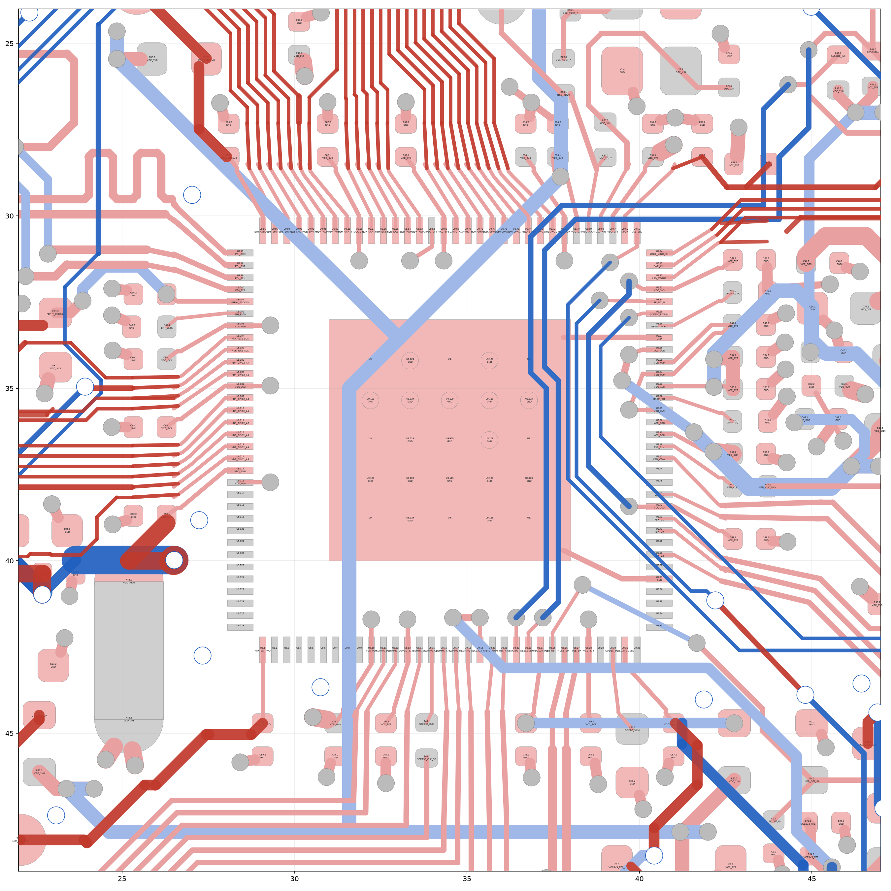
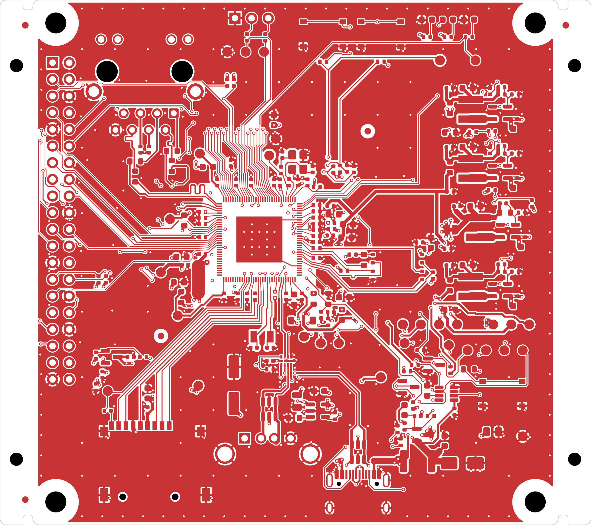
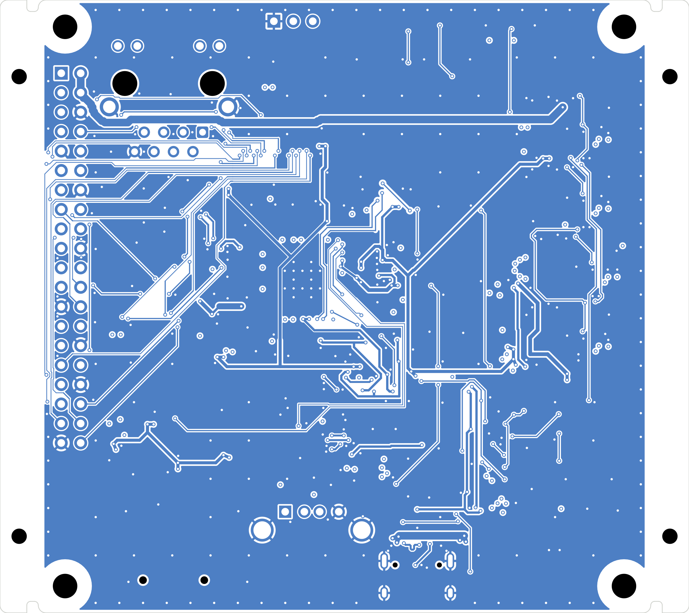
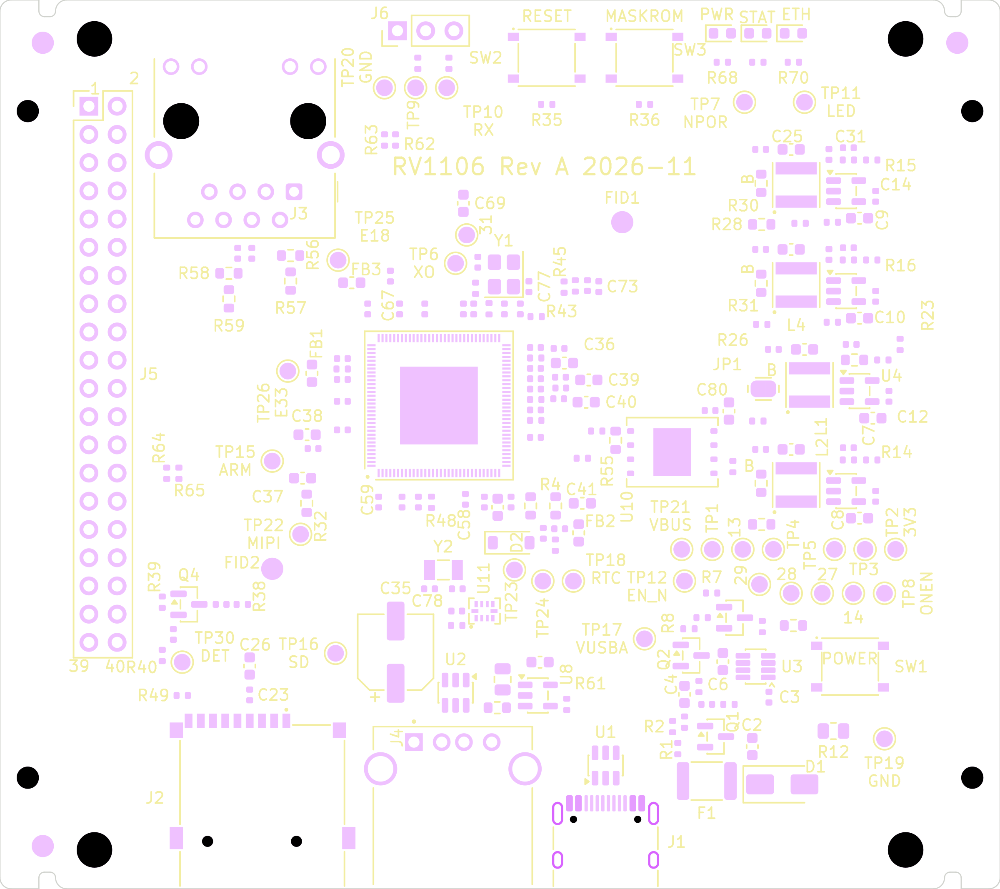

# Routing review — layout phase L5 (remaining routing and finishing), round 4 — CHECKPOINT 2, updated for L5F

> **L5G update (2026-11-07, owner decision D-H7 "Yes, fix and accept", D-119..D-127; round 2 D-128..D-131):** U9 EP
> vias are 16 GND board vias (ViaDrill, 670 vias) with board-wide via filling + capping, and U9 uses the board.pretty
> variant without drilled pads (no U9 library mismatch); silk labels follow a nearest-own-copper rule with a 0.20 mm
> margin (0 of 143 break it, smallest margin 0.21 mm, 19 references hidden, TH texts gone, TP3 printed "TP3");
> SDMMC_CLK_SD >= 0.305 mm from every SD / NAND line; C58 moved 0.176 mm E / 0.25 mm N (recorded local move, owner to
> confirm, D-128) so RTC_XOUT is >= 0.500 mm from SDMMC_D2 along the whole route and the XIN-XOUT run < 0.5 mm is
> 1.88 mm; J5.2 link pad centre to pad centre; J1-shell vias 0.472 mm hole to slot; every In2 hop island 2 GND vias;
> Q1 drain 5 vias; a scripted USB / ETH pair report. Numbers and guards per item: **`fix-review-l5g.md`**. Current
> totals: DRC 0 errors / 0 unconnected (152 lib_footprint_mismatch warnings, all on purpose), check_routing 602 checks /
> 0 FAIL / 68 DEV; mutations L5G 18 / 18 caught.

> **L5F update (2026-11-07, owner decision D-H6, D-117):** the CHECKPOINT-2 review list was fixed in phase L5F; what
> **L5F round 2 (2026-11-07, D-118):** V-cut clearance now met everywhere (J5 west lanes re-routed), rail notches 1.5 mm with R 0.5 mm corners, neck-downs keep wide copper off the pads, TP bare-number labels; final numbers in fix-review.md "Results".
> changed per item, with before/after numbers and the check that guards it, is in **`fix-review.md`**. The numbers and
> the §10 checklist below are re-measured on the L5F board; the round-4 narrative sections describe the L5 routing
> (still valid except where fix-review.md says otherwise: buck cells, enable nets, pours, silk, outline).

Board `design/pcb/rv1106-reva.kicad_pcb` (open `design/pcb/rv1106-reva.kicad_pro` in KiCad 10). Coordinates are board mm
from the north-west corner (x east, y south); that corner is at page (50, 50) mm (D-100). Decisions: D-113 (round 1),
D-114 (round 2), D-115 (round 3), **D-116 (this round)**. Measured table: `routing-report.md` (L5 section, generated).
Checker output: `check_routing.txt`. Rebuild: `sh design/pcb/scripts/rebuild_all.sh` (from the netlist, 13.5 min;
`L5_FR_RERUN=1` also re-runs Freerouting, otherwise the stored session `l5/fr/out.ses` is re-imported).

## Status in one paragraph

**Every net is routed: KiCad DRC shows 0 errors and 0 unconnected items, so gate TP-L5 is met and this is CHECKPOINT 2.**
The SoC can now switch SD-card power (SDMMC_PWREN), drive the USB mux select (USB_SEL) and the USB-A VBUS enable
(USBA_VBUS_EN), read the PMIC interrupt (PB_INT_N) and drive the status LED. HDR_GPIO2_A7 reaches the header, and the
I2C3 pull-ups and the codec test pad are connected. To get there, the two L4 SENSE tracks were re-routed, the east and
west lane plans were redone, and the codec supply loop was rebuilt. Four parts moved: two test pads and the two I2C3
pull-ups. You have four decisions to make (below). The main one is the via-in-pad choice for six pads.

## Numbers (final board, clean-tree rebuild)

| Item | Result |
|---|---|
| KiCad DRC (`kicad-cli pcb drc --severity-all`, zones refilled) | **0 errors, 0 unconnected items.** Warnings: lib_footprint_mismatch 152 only (L5F: track_dangling 42 → 0, via_dangling 2 → 0, silk_edge_clearance 2 → 0; explained below) |
| `check_routing.py` (final board, L5F) | 565 checks: 457 PASS, 70 DEV, 38 INFO, **0 FAIL** (incl. the L5F checks of `l5fcheck.py`) |
| L3 board check / L4 board check during the rebuild | 419 checks, 0 FAIL / 509 checks, 0 FAIL |
| `check_placement.py` | 339 checks, 277 PASS, 62 DEV, 0 FAIL; `tools/check_layout.py` 1259 PASS, 0 FAIL |
| Rebuild from a clean tree | `rebuild_all.sh` (now ending with `l5f_run.sh`) runs through; the rebuilt board equals the delivered one (3778 tracks + vias, all footprints identical) |
| L5 copper | 818 segments, 120 vias, 2197 mm (groups L5_LANES, L5_PRIORITY, L5_NORTH, L5_FREEROUTE, L5_SCRIPT, **L5_FINISH**); GND stitching 185 + 6 island vias |
| L4 rules re-measured after the clean-up | ETH RX skew -0.59 mm (U9 -> link) / -0.00 mm (U9 -> J3), TX -0.29 mm; USB skews -0.61 / -0.50 / -0.00 / -0.00 mm; USB lines 0 items below 0.76 mm (breakout courtyards excepted); SENSE to SW nodes and inductors **2.26 mm** min (new check, >= 2.0) |

## What was routed this round and how (D-116, `scripts/l5_finish.py` -> group L5_FINISH)

Every hand-placed piece is a 0/45/90° polyline checked against the whole board with the exact rule model
(`l4lib`, the same model the L4 router uses). The long legs were routed by the L4/L5 router. KiCad DRC is the final judge.

1. **SENSE pair re-routed on L4** (verifier major onoff). RECOVERY and SARADC_IN1 leave their escape vias south of U9
   and run up the corridor west of the inner vias (x 36.85-37.65, west of the VDD_0V9 via (37.83, 31.30)). They then
   run east under the north pad row (y 29.70 / 30.10) and turn north beside the VCC_1V8 rail (x 43.60 / 44.05) to their
   end vias at R44/R45. They no longer enclose the inner vias of USB_SEL, PB_INT_N and SDMMC_PWREN.
2. **VCC_3V3 pin 61 (an L3 change):** its inner via (39.70, 31.90) had an L4 link north to a plane via, and that link
   split the field. The link is gone. The via is now joined on L4 to the pin-43 inner via (39.70, 38.43), which reaches
   the plane through C63. The track is 0.15 mm, because hole clearance between the PB_INT_N and SDMMC_PWREN vias allows
   no more. It feeds one VCC pin.
3. **USB_SEL, SDMMC_PWREN, PB_INT_N** leave the U9 field on L4 (0.10 mm inside the field) through the south-east
   corridor.
   - USB_SEL and SDMMC_PWREN run south between the codec link and the VCC_1V8 rail (x 47.58 / 47.84), then west along
     y 52.75-53.11.
   - USB_SEL ends at a via at (34.00, 55.60). From there it runs on L1 along y 54.40 to U11.9, south of the RTC
     crystal's 1 mm guard, and on to R60.1.
   - SDMMC_PWREN continues to R38 (1 via).
   - PB_INT_N goes to L1 at (42.20, 41.15) and reaches R10/U3 (5 vias).
4. **C84.1's plane via** moved from (36.41, 54.35) onto the C84.1-U11.10 L1 link at (37.13, 55.00). This frees the
   USB_SEL entry to U11.9.
5. **Codec rail (VCC1V8_CODEC)** rebuilt inside the new nets: C57 -> via (40.43, 48.55) -> L4 loop along y 51.74 ->
   FB2.2 via -> C41 via north of C41.1 (46.90, 44.40). TP24 moved next to the loop and TP18 next to its rail (decision 1).
   Each is joined by a via beside the pad, so TP18 has no via in its pad any more.
6. **East lanes (pins 64/63/62)** re-planned on L1 (0.10 mm) in the channel between NPOR and the VCC_DDR copper.
   - LED_STATUS goes north past PWR_KILL's via to LED2 (2 vias).
   - PWR_KILL keeps its via (57.84, 27.48).
   - USBA_VBUS_EN drops to L4 at (49.50, 27.35), north of the neck. It returns to L1 for 4 mm at (49.51, 33.09) to cross
     the VCC_1V8 L4 diagonal, and reaches R61/U8.
   - That is one new via in the VDD_0V9 neck box, 2.3 mm south of the free strip STRIP-N. The strip keeps its 2.7 mm of
     continuous copper, the neck cross-section check passes, and the via is added to the inventory.
   - **No via in STRIP-N**, so the round-2/3 owner question (D-114 k) is closed without one.
7. **HDR_GPIO2_A7 / A6:** A6's lane route is redone after A7. A7 takes the path north of A6, both on L1, 0 vias.
8. **I2C3 pull-ups R62 / R63** moved next to the I2C3 lanes north-west of U9 (decision 1). They join on L1 (2.6 / 3.2
   mm), with their VCC_3V3 vias north of the pads.
9. **Clean-up** (verifier minor soc):
   - the NPOR near-duplicate pair at C71.1 is removed;
   - `scripts/l5_tidy.py` removes L5 segments that lie on another same-net track (UART2_RX at R67.2) and merges the
     pieces shorter than 10 µm (VDD_ARM, PB_INT_N, PWR_EN) into their neighbours;
   - the VDD_ARM C38 branch now starts at its via centre (it was joined by overlap only);
   - the 0.24 mm VCC1V8_CODEC stub is gone with the old loop.
   New FAIL checks cover redundant segments and joints under 5°. Both are 0.
10. **Silk** (verifier minor ui): PWR / STAT / ETH sit in one row centred over LED1-3. The LED references are hidden
    (kept on F.Fab), as for R69/R70.
11. **Checks added** (`l5check.py`, all on the board):
    - ring-2 copper path for every part named by the rule;
    - SENSE to SW-node / inductor distance;
    - vias in SMD pads;
    - redundant segments and sliver joints;
    - L5_FINISH counted as L5 copper.
    The escape check accepts a lane whose L1 copper continues through the gate from an inner vertex; the replaced
    escape pieces are listed in D-116 f/g.

## Images (look at them in this order)

| Image | What it shows |
|---|---|
|  `renders/route_l5_u9_l1l4.png` | **L1 (red) + L4 (blue) around U9; dark = L5 copper.** The SENSE pair up the west corridor and east under the north pads, the inner nets in the corridor and down the south-east, and the east lanes in the NPOR channel |
|  `renders/route_l5_F_Cu.png` | L1 with GND pour |
|  `renders/route_l5_B_Cu.png` | L4 with GND pour: the USB_SEL / SDMMC_PWREN runs at y 52.8-56.2 and the codec loop at y 51.74 |
| `renders/route_l5_south.png`, `_east.png`, `_west.png`, `_north.png` | close-ups: L5 copper dark over the board |
| `renders/route_l5_In1_Cu.png`, `route_l5_In2_Cu.png` | L2 solid GND, L3 planes |
|  `renders/route_l5_silk.png` | silkscreen + mask (LED labels PWR / STAT / ETH in one row) |
| `renders/route_l5_3d_top.png` | 3-D render (J2/J4 have no models; the §10 3-D item is measured from F.Fab, L5-3d lines) |

## Decisions for you (CHECKPOINT 2)

**1. Approve the local moves** (rounds 3 and 4). These are relocations, not the small moves D-H5 allows. The current
zones are written in `layout/placement.csv`, and testpoints.md / bringup.md are updated.

| Part | From -> to | Why |
|---|---|---|
| R66 / R67 (UART2 series) | strip north of U9 -> Z-UART beside J6 / TP9 / TP10 (17-19 mm) | free the north exit of U9 (D-115 a) |
| TP15 (VDD_ARM) | power test row -> (19.50, 41.50), 3.4 mm from C44 (48 mm) | removes a 58 mm load-free L4 branch on the core rail; **TP15 is no longer in the power test row**, so probe it with any GND |
| TP23 / TP18 | NE corner -> south of U9 (28 mm); round 4: TP18 (46.90, 50.70) -> (46.60, 52.30) | next to their rails; TP18 without a via in its pad |
| TP24 (VCC1V8_CODEC) | (51.00, 46.20) -> (43.85, 52.30) | it was isolated from its rail on both layers; it is now on the codec loop |
| R62 / R63 (I2C3 pull-ups) | Z-HDR (10.0/11.1, 35.2) -> (30.60/29.60, 12.60), turned 180° | beside the I2C3 lanes, which run 20 mm away from Z-HDR |
| TP31, FB3, C69 (round 3) | as D-115 a | north exit corridors |

**2. Via in pad: 6 pads** (L5F / L5G: the POFV list is `via_in_pad.csv`, 29 rows incl. C58.2 since D-128). The pads are C47.1, C58.1, C66.1, C69.1, FB2.2 and R33.2. D-67 (no via-in-pad filling,
"POFV") contradicts them. Each pad is boxed in on L1, and no via site beside the pad was found. TP18's via in pad is gone.
Choose:
- **(a) Order POFV.** JLCPCB lists "Via-in-Pad: epoxy filled & capped" (`refs/jlcpcb-pcb-capabilities-2026-10-29`). It is
  free on 6-20 layers and charged on 4 layers. **The 4-layer price is UNVERIFIED:** it only shows in the quote form, and
  I did not submit any form. Check it when you order. This changes D-67.
- **(b) Keep D-67.** The 6 pads then carry open 0.3 mm vias in 0402/0603 pads, with a risk of solder wicking (open or
  weak joints on decoupling caps / a ferrite / the 1 R USB filter). A fix would need placement moves of these ring-1/2
  parts.
My recommendation is (a).

**3. Ring-2 lengths along the copper** (layout.md §5.3: at most 8 mm from the pin). Measured now for every ring-2 part
(check L5-ring2):
- Within 8 mm: FB1 6.49, FB3 5.73, NT1 4.96 mm.
- Recorded DEVs:
  - VCC1V8_CODEC: FB2 22.0, C41 25.8, TP24 15.9 mm. The codec is unused (D-12), and the loop goes round the VCC3V3_RTC /
    AVDD1V8_USB / VCC_1V8 copper south of U9.
  - MIPI_CSI_AVDD_1V8: R32 14.9, TP22 10.6 mm. The camera is unused (D-12). R32 still reaches U9.1 through TP22.
  - VCC3V3_RTC: R34 17.7, D2 25.0, TP18 21.1 mm. The load is µA and there is no battery (D-75).
  - AVDD1V8_USB: R33 8.26, TP23 17.1 mm. 30 mA through 1 R.
  - TP25 8.60 and TP26 8.91 mm.
  - VDD_ARM: C44 10.55 and C38 12.99 mm (D-114 e).
  - C69 13.85 mm (D-115 a).
These are DC sub-rails with bulk or test parts. Bringing them under 8 mm needs parts moved into the ring-1 band.
**Approve the DEVs, or name the rails you want shortened.**

**4. Still open from earlier rounds:**
- 0.8 mm LED labels (PWR / STAT / ETH, D-114 g).
- The **CC1 via (47.64, 68.15) is 0.45 mm from USBC_DP.** The round-3 review said it was gone, and that was wrong. The
  USBC_DP segment lies inside U1's courtyard, so the DRU breakout exemption applies (D-116 l).
- JLC impedance cross-check (H2).

## DRC warnings explained

- **lib_footprint_mismatch 152:** the board footprints differ from their library copies on purpose: silk lines widened
  to 0.15 mm and trimmed 0.15 mm from pads (D-117 i), solid zone connection on the buck GND pads (D-117 a). This Mac has
  no global footprint table; the footprints are stored in the board and `board.pretty/`. Not a board defect.
- track_dangling, via_dangling, silk_edge_clearance: 0 since L5F (D-117 g, i).

## layout.md §10 checklist (evidence, L5F board)

Setup
- [x] Stackup 4 layers, 1.6 mm — build_board.py (L2).
- [x] Constraints — `.kicad_dru` + board setup; DRC 0 errors.
- [x] Net classes — pad nets = board.net, PASS.
- [x] DRU loaded, syntax OK.
- [x] Diff-pair naming limitation documented — D-112 d.
- [x] Custom footprints checked — TP-L1.
- [ ] JLCPCB impedance calculator cross-check — UNVERIFIED (owner, H2).

Outline and mechanics
- [x] Edge.Cuts 80 × 80 with **R 1 mm corners on the board itself** (1.5 × 1.5 mm rail notches with R 0.5 mm air-side corners, D-117 h / D-118 c; L5F-edge 4/4, outline closed, 0 router-bit cusps); V-CUT = User.1, lines x = 0 / 80, plots (L5F-edge).
- [x] Fiducials, tooling holes, M3 keep-outs — L2.
- [x] Connector faces on their edges — L5-3d PASS.
- [x] **Copper ≥ 0.8 mm from the V-cuts** (L5F-vcut, no exception: pours 0.80 mm, tracks ≥ 0.8002 mm, vias ≥ 0.81 mm; the three J5 west lanes re-routed, D-118 a, D-117 d withdrawn); routed edges ≥ 0.3 mm (DRC).
- [x] Via in pad: POFV (D-H6); 28 rows in `via_in_pad.csv`, exact (L5F-vip).

Placement
- [x] As approved (D-H5) plus the recorded moves; L5F local cap moves inside the buck cells (D-117 a); final-board zone check L5F-zone 0 unrecorded; check_placement / check_layout 0 FAIL.
- [x] Buck cells: input-cap GND → pin 2 along L1 2.03 / 2.84 mm (≤ 3), pin 2 solid with 2 GND vias ≤ 1 mm (L5F-buck, all four cells).

Routing
- [x] ETH / USB pairs — unchanged by L5F (L4 checks PASS / DEV as recorded).
- [x] SDMMC / FSPI — unchanged.
- [x] SW nodes; FB ≥ 2 mm (2.79 mm); **EN / PWR_EN / PB ≥ 1 mm from SW copper (1.01 mm), none in an inductor courtyard** (L5F-sw).
- [x] Power widths / via counts — PASS/DEV as before; U9 supply layer changes ≥ 2 vias (the former stub vias linked on L4).
- [x] **L4 pair hops over In2 GND: 21 of 21 segments** (L5F-hop); GND via ≤ 1 mm of 11 of 16 pair vias, 5 recorded (D-117 f; unchanged in round 2, reason D-118 b, owner item).
- [x] No tracks wider than a 0402/0603 pad's narrow side into it (L5F-neck); all L5 pieces 0/45/90 deg (L5F-geom).
- [x] All nets routed — 0 unconnected items.
- [x] Ring 2 ≤ 8 mm along the copper — DEVs as recorded (D-116 j).

Planes and thermal
- [x] L2 solid GND, no tracks; L3 regions per planes.csv + the In2 GND hop islands (D-117 f).
- [x] U9 / FB / SW pad DRC — 0 errors.
- [x] EP vias, windowpane paste, QFN mask — L1/L3; EP vias filled and capped with POFV.
- [x] GND stitching — as in round 4 (D-113 d DEVs).

Final
- [x] DRC 0 errors, 0 unconnected; warnings: lib_footprint_mismatch only (explained above); track_dangling / via_dangling 0.
- [x] Silk: lines ≥ 0.15 mm, texts ≥ 1.0 mm / 0.15 mm (LED labels PWR / STAT / ETH at 1.0 mm), nothing beyond the edge (L5F-silk); ≥ 0.15 mm from pads (L5-silk); R62 / R63 references beside their parts; TP3, TP13, TP14, TP27–TP29 labelled with their bare number on silk ("TP<n>" + net on F.Fab, D-118 d).
- [x] 3-D: connectors on edges, 0 bottom-side parts — L5-3d PASS.
- [ ] Fabrication outputs — L6. [ ] Depaneling — after delivery.

## What to look at in KiCad

- L4 under U9 (x 36-48, y 26-44): the SENSE pair and the four inner-via tracks (USB_SEL, PB_INT_N, VCC_3V3,
  SDMMC_PWREN) in the west corridor.
- South-east of U9 (x 44-48, y 41-53): USB_SEL / SDMMC_PWREN beside the VCC_1V8 rail; the codec loop (y 51.74); TP18 /
  TP24 and their vias.
- U11 (x 34-38, y 53-57): USB_SEL on L1 at y 54.40 below the RTC crystal guard, and C84.1's moved plane via.
- East of U9 (x 42-59, y 27-31): the three east lanes in the NPOR channel; USBA_VBUS_EN's neck via (49.51, 33.09).
- North-west (x 29-31, y 11-14): R62 / R63 at their new place.
- The 6 vias in pads (decision 2).
- Groups: L5_FINISH (this round), L5_LANES, L5_PRIORITY, L5_FREEROUTE, L5_SCRIPT, L5_STITCH, L5_STITCH2, L5_SILK.
